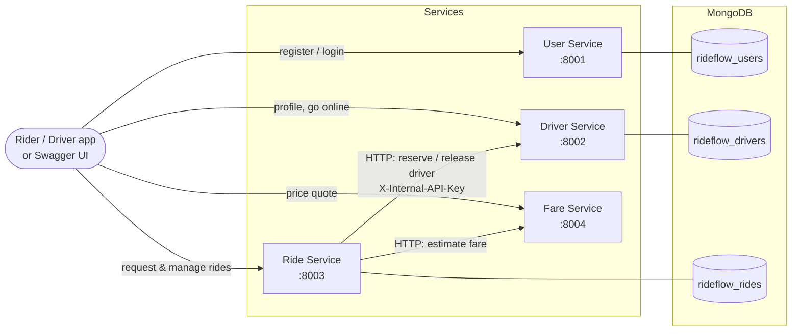
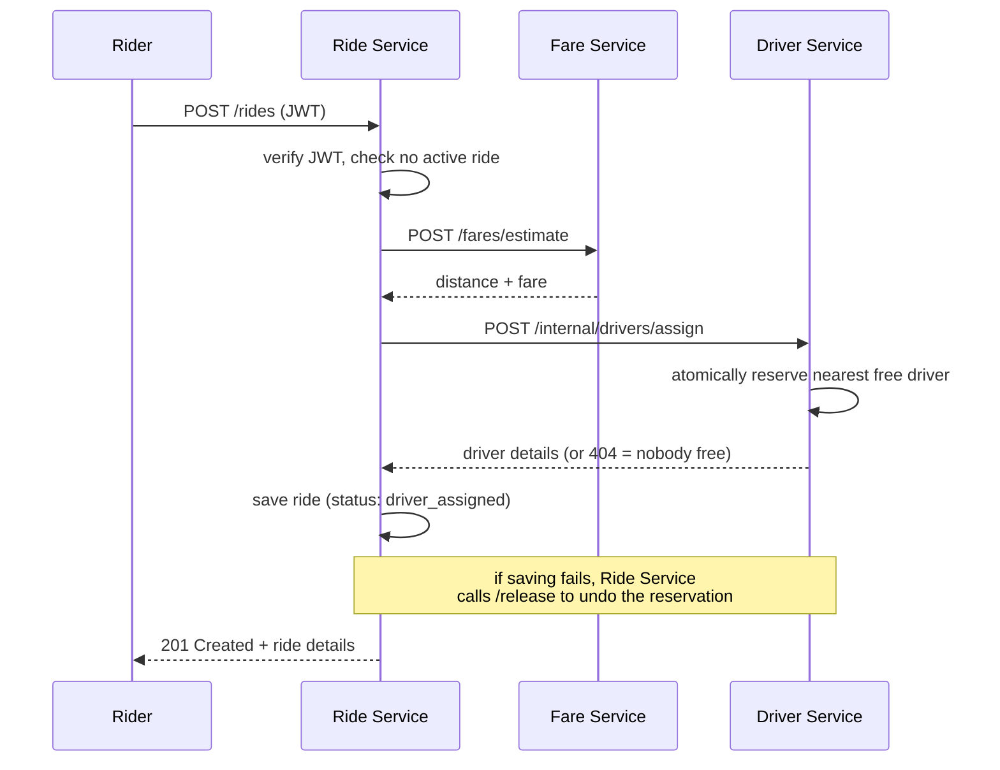
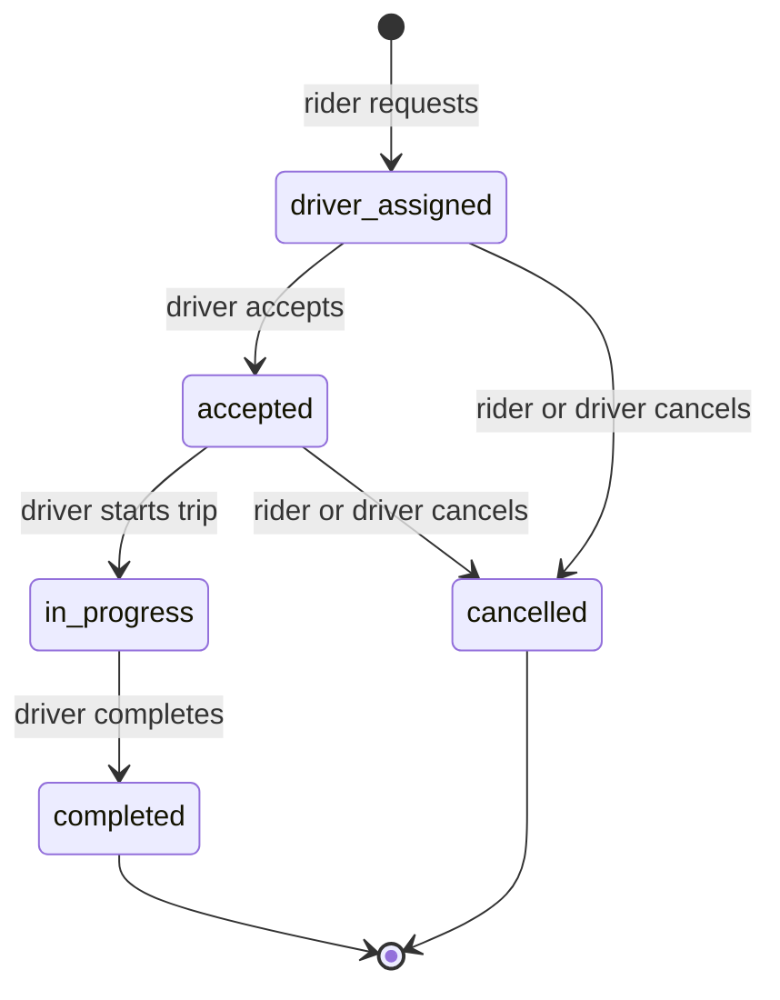

# RideFlow

A ride-hailing backend inspired by apps like Uber, built as **four small FastAPI
microservices** that talk to each other over HTTP and store data in MongoDB.

Riders sign up, get a fare quote and request a ride; the system reserves the
nearest available driver; the driver accepts, starts and completes the trip;
both sides can see their trip history.

> This is a learning/portfolio project. It demonstrates backend and
> microservice fundamentals. It is **not** a reproduction of Uber's real
> architecture, which involves far more (real-time location streaming,
> payments, surge pricing, maps routing, and so on).

---

## Architecture



| Service | Port | Responsibility | Database |
|---|---|---|---|
| **User** | 8001 | Register, login (issues JWTs), user profiles, rider/driver roles | `rideflow_users` |
| **Driver** | 8002 | Vehicle profile, online/offline, nearest-driver selection | `rideflow_drivers` |
| **Ride** | 8003 | Ride requests, assignment, status changes, trip history | `rideflow_rides` |
| **Fare** | 8004 | Fare estimate = max(base + km x rate, minimum) | none (stateless) |

### What happens when a rider requests a ride



### Ride status lifecycle



Any other move (e.g. completing a ride that was never started) returns
**409 Conflict** with a message listing the allowed next statuses. The rules
live in one table in `services/ride_service/state_machine.py`.

---

## Project structure

```
rideflow/
├── shared/                     # code every service uses
│   ├── config.py               # settings from environment variables / .env
│   ├── security.py             # password hashing + JWT (no FastAPI imports)
│   ├── auth.py                 # FastAPI dependencies: current user, roles, internal key
│   ├── database.py             # one MongoClient per process
│   ├── service_client.py       # httpx wrapper -> clear errors for 503 / 502
│   ├── geo.py                  # haversine distance
│   └── schemas.py              # Location model
├── services/
│   ├── user_service/           # main.py, routes.py, schemas.py, repository.py, database.py
│   ├── driver_service/         # same layout
│   ├── ride_service/           # + state_machine.py, clients.py
│   └── fare_service/           # + pricing.py (no database)
├── tests/                      # pytest suite (uses in-memory mongomock)
├── scripts/
│   ├── run_all.py              # start all four services at once
│   └── demo.py                 # scripted end-to-end ride against running services
├── requirements.txt
├── .env.example
└── pytest.ini
```

Every service follows the same layering, so once you understand one you
understand them all:

- **`main.py`** creates the FastAPI app, registers routers and startup logic.
- **`routes.py`** handles HTTP: validates input, checks permissions, returns responses.
- **`schemas.py`** holds Pydantic models (request/response shapes and validation).
- **`repository.py`** holds every MongoDB query. Routes never query Mongo directly.

---

## Setup

### 1. Prerequisites

- **Python 3.12+**: check with `python --version` (or `python3 --version`).
- **MongoDB Community Server** running locally on the default port 27017.

Install MongoDB (free, local):

- **Windows:** download the MSI from <https://www.mongodb.com/try/download/community>
  and keep "Install MongoD as a Service" ticked. It starts automatically.
  Check with PowerShell: `Get-Service MongoDB`
- **macOS (Homebrew):**
  ```bash
  brew tap mongodb/brew
  brew install mongodb-community
  brew services start mongodb-community
  ```
- **Ubuntu/Debian:** follow the official guide for your version at
  <https://www.mongodb.com/docs/manual/administration/install-on-linux/>, then
  `sudo systemctl start mongod`

Optional: install **mongosh** (MongoDB Shell) to look at your data and check the
server is up: `mongosh --eval "db.runCommand({ ping: 1 })"` should print `ok: 1`.

**Database setup:** nothing to do by hand. MongoDB creates the three databases
and their collections on first write, and each service creates its indexes
when it starts.

### 2. Install the project

From the `rideflow/` folder:

**macOS / Linux**
```bash
python3 -m venv .venv
source .venv/bin/activate
pip install -r requirements.txt
cp .env.example .env
```

**Windows (PowerShell)**
```powershell
python -m venv .venv
.venv\Scripts\Activate.ps1
pip install -r requirements.txt
Copy-Item .env.example .env
```

> If PowerShell blocks the activate script, run
> `Set-ExecutionPolicy -Scope CurrentUser RemoteSigned` once.

### 3. Set your secrets

Open `.env` and replace `JWT_SECRET_KEY` and `INTERNAL_API_KEY`. Generate
values with:

```bash
python -c "import secrets; print(secrets.token_urlsafe(48))"
```

`JWT_SECRET_KEY` must be at least 32 characters, or the services refuse to start.

---

## Running the services

Each service is an independent process. With your virtual environment
activated, from the `rideflow/` folder, open **four terminals**:

```bash
uvicorn services.user_service.main:app   --port 8001 --reload
uvicorn services.driver_service.main:app --port 8002 --reload
uvicorn services.ride_service.main:app   --port 8003 --reload
uvicorn services.fare_service.main:app   --port 8004 --reload
```

Or start all four from one terminal (Ctrl+C stops them all):

```bash
python scripts/run_all.py
```

Swagger docs:

- User: <http://127.0.0.1:8001/docs>
- Driver: <http://127.0.0.1:8002/docs>
- Ride: <http://127.0.0.1:8003/docs>
- Fare: <http://127.0.0.1:8004/docs>

### Try it: automatic demo

With all services running, in another terminal:

```bash
python scripts/demo.py
```

It registers a rider and a driver, puts the driver online, books a ride and
drives it to completion, printing each step. It's safe to run repeatedly: the
pickup point shifts slightly each run and the demo driver goes offline at the
end, so leftover drivers from earlier runs don't steal the ride.

### Try it: by hand in Swagger

1. **User Service** `/docs` → `POST /auth/register` twice: one user with
   `"role": "rider"`, one with `"role": "driver"`.
2. `POST /auth/login` for each and copy the `access_token` values.
3. **Driver Service** → click **Authorize**, paste the *driver* token →
   `POST /drivers/me` with a vehicle and location →
   `PATCH /drivers/me/availability` with `{"is_available": true}`.
4. **Ride Service** → Authorize with the *rider* token → `POST /rides`:
   ```json
   {
     "pickup":  {"latitude": 12.9758, "longitude": 77.6050},
     "dropoff": {"latitude": 12.9784, "longitude": 77.6408}
   }
   ```
5. Re-authorize with the *driver* token → `GET /rides/me?status=driver_assigned`
   to find the ride, then `POST /rides/{id}/accept`, `/start`, `/complete`.

The driver's pickup location must be within `MAX_DRIVER_SEARCH_KM` (default
10 km) of the rider's pickup point.

---

## Running the tests

```bash
pytest
```

Tests need **no running MongoDB and no running services**:

- `mongomock` gives each test a fresh in-memory database, swapped in through
  FastAPI's `dependency_overrides`.
- The Ride Service tests talk to the **real** Fare and Driver apps through
  FastAPI `TestClient`s, so service-to-service calls are genuinely exercised.
- Failure tests use `httpx.MockTransport` to simulate a service that is down
  or returning errors.

What's covered: password hashing, JWT expiry/tampering, fare maths, the state
machine (every legal and several illegal moves), registration/login rules,
role checks, internal-key protection, nearest-driver selection, double-booking
prevention, active-ride limits, cancellation releasing the driver, drivers
moving to the drop-off point after a trip, passwords kept exactly as typed,
503/502 handling, and a full end-to-end journey using real login tokens.

---

## API overview

| Service | Method & path | Who | Purpose |
|---|---|---|---|
| User | `POST /auth/register` | anyone | create rider/driver account |
| User | `POST /auth/login` | anyone | get JWT |
| User | `GET/PATCH /users/me` | logged in | view / edit profile |
| Driver | `POST /drivers/me` | driver | create vehicle profile |
| Driver | `GET /drivers/me` | driver | view own profile |
| Driver | `PATCH /drivers/me/availability` | driver | go online/offline, update location |
| Driver | `GET /drivers/available` | logged in | list online drivers |
| Driver | `POST /internal/drivers/assign` | services only | reserve nearest driver |
| Driver | `POST /internal/drivers/{id}/release` | services only | free a driver (and, on completion, move them to the drop-off point) |
| Ride | `POST /rides` | rider | request a ride |
| Ride | `GET /rides/me?status=` | logged in | trip history |
| Ride | `GET /rides/{id}` | rider/driver of that ride | ride details |
| Ride | `POST /rides/{id}/accept`, `/start`, `/complete` | assigned driver | move ride forward |
| Ride | `POST /rides/{id}/cancel` | rider or assigned driver | cancel before the trip starts |
| Fare | `POST /fares/estimate` | anyone | price quote |
| Fare | `GET /fares/rates` | anyone | current pricing |

All services also expose `GET /health`.

### Error responses you'll see

| Code | Meaning in RideFlow |
|---|---|
| 401 | missing, invalid or expired token; wrong login |
| 403 | wrong role (e.g. a driver requesting a ride), or missing internal key |
| 404 | not found, *or* not yours (we don't reveal other people's rides) |
| 409 | conflict: duplicate email/plate, illegal status change, no drivers available, rider already has an active ride |
| 422 | invalid input (bad email, coordinates out of range, pickup = dropoff, ...) |
| 502 | another service answered with an unexpected error |
| 503 | another service is down or timed out |

---

## Key design decisions (in plain English)

**Database per service.** Each service owns its own MongoDB database and no
service reads another's. If the Ride Service needs driver data, it asks the
Driver Service over HTTP. This keeps services independent: you could change
how drivers are stored without touching the Ride Service. (They share one
MongoDB *server* locally purely for convenience.)

**JWTs verified locally.** The User Service signs a token containing the user's
id, role and name. Every other service checks the signature with the shared
secret, so they don't need to call the User Service on every request. The
trade-off: all services share one secret. In production you'd sign with a
private key (RS256) and give other services only the public key.

**Internal API key for service-to-service calls.** Endpoints like "reserve a
driver" must not be callable by users. They require an `X-Internal-API-Key`
header that only the services know. Production systems would use mutual TLS or
a service mesh; a shared key teaches the same idea simply.

**No double-booking (atomic compare-and-set).** Two riders might request at the
same instant and both pick the same nearest driver. We never "read then write".
Instead `find_one_and_update` only succeeds if the driver is *still* free, and
MongoDB applies single-document updates atomically, so exactly one request wins
and the other moves on to the next-nearest driver.

**Safe status changes (optimistic concurrency).** Status updates include the
expected current status in the filter. If the rider cancels at the same moment
the driver presses "start", only one update matches; the other gets 409 instead
of silently overwriting.

**Compensating action instead of a distributed transaction.** Reserving a driver
(Driver DB) and saving the ride (Ride DB) can't share one database transaction.
If saving the ride fails after the driver was reserved, the Ride Service calls
`/release` to undo it. This is the core idea behind the "saga" pattern.

**Clear failure handling between services.** `shared/service_client.py` turns
connection errors and timeouts into `ServiceUnavailableError` (→ 503) and
unexpected responses into `UpstreamServiceError` (→ 502), handled in one place
in the Ride Service. Every call has a timeout so a slow service can't hang
requests forever. We **don't** auto-retry, because retrying "reserve a driver"
after a lost response could reserve a second driver.

**Synchronous endpoints.** PyMongo is a blocking library, so endpoints are plain
`def` functions. FastAPI runs those in a thread pool, which keeps the event loop
free. Mixing `async def` with blocking calls would stall the whole server.

**Password hashing with PBKDF2 (standard library).** A random salt per password
and 600,000 iterations (OWASP's recommendation for PBKDF2-SHA256), compared in
constant time. Using the standard library means no native build dependencies.
bcrypt or Argon2 are equally good choices.

**String UUIDs as MongoDB `_id`.** Simpler to send in JSON than MongoDB's
`ObjectId`, and no conversion code needed. A driver's profile `_id` is their
user id, which enforces "one profile per driver" for free.

**Drivers end up where the trip ended.** When a ride completes, the Ride
Service sends the drop-off point along with the release call, so the Driver
Service updates the driver's location. Without this, a driver would still be
matched as if standing at their *first* pickup point. (A real app streams
live GPS instead; see limitations.)

**Pure logic kept separate.** Pricing, distance, hashing/JWT and the state
machine have no FastAPI or MongoDB imports, so they're easy to test and reason
about.

---

## Known limitations and next steps

These are honest gaps, and good interview discussion points:

- **Driver release is best-effort.** If the Driver Service is down when a ride
  completes, the ride still completes but the driver stays "busy". Release is
  idempotent, so a background job could retry it; a message queue or an
  "outbox" table would make it reliable.
- **Active-ride check can race.** Two simultaneous requests from the same rider
  could both pass the check. A unique partial index on `(rider_id)` for active
  statuses would close that gap.
- **Straight-line distance.** Haversine, not road distance. Real systems use a
  routing engine.
- **Geo search in Python.** Fine for a demo; at scale use a MongoDB `2dsphere`
  index with `$near`.
- **No driver decline / re-matching**, no real-time location updates
  (WebSockets), no payments, no refresh tokens, no rate limiting.
- **Money as rounded floats.** Production systems store integer minor units
  (paise/cents) or `Decimal`.

---

## Troubleshooting

- **`ServerSelectionTimeoutError` on startup:** MongoDB isn't running or
  `MONGODB_URI` is wrong. Start MongoDB and retry.
- **`Missing required environment variable 'JWT_SECRET_KEY'`:** you haven't
  created `.env` (copy `.env.example`).
- **`ModuleNotFoundError: No module named 'services'`:** run commands from the
  `rideflow/` folder, not from inside `services/`.
- **Ride request returns 503:** start the Fare (8004) and Driver (8002)
  services; the Ride Service depends on them.
- **Ride request returns 409 "No drivers available":** make sure a driver is
  online and within 10 km of the pickup point.
